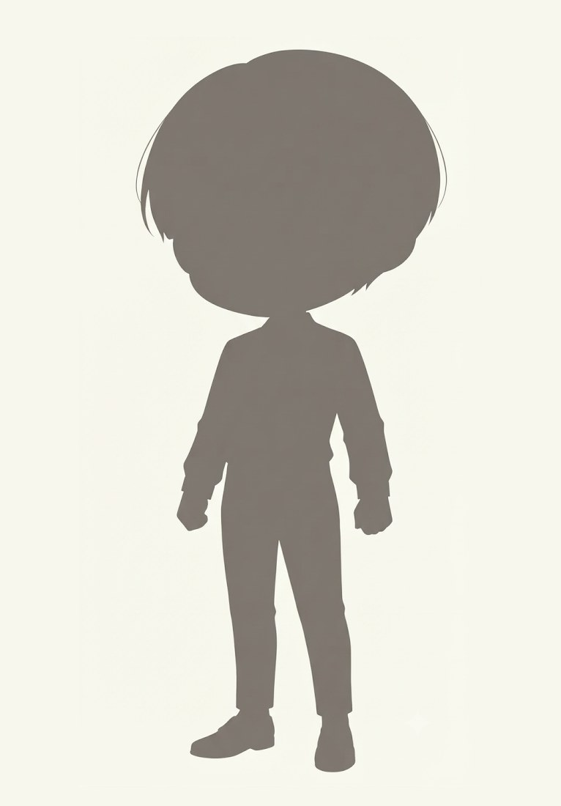
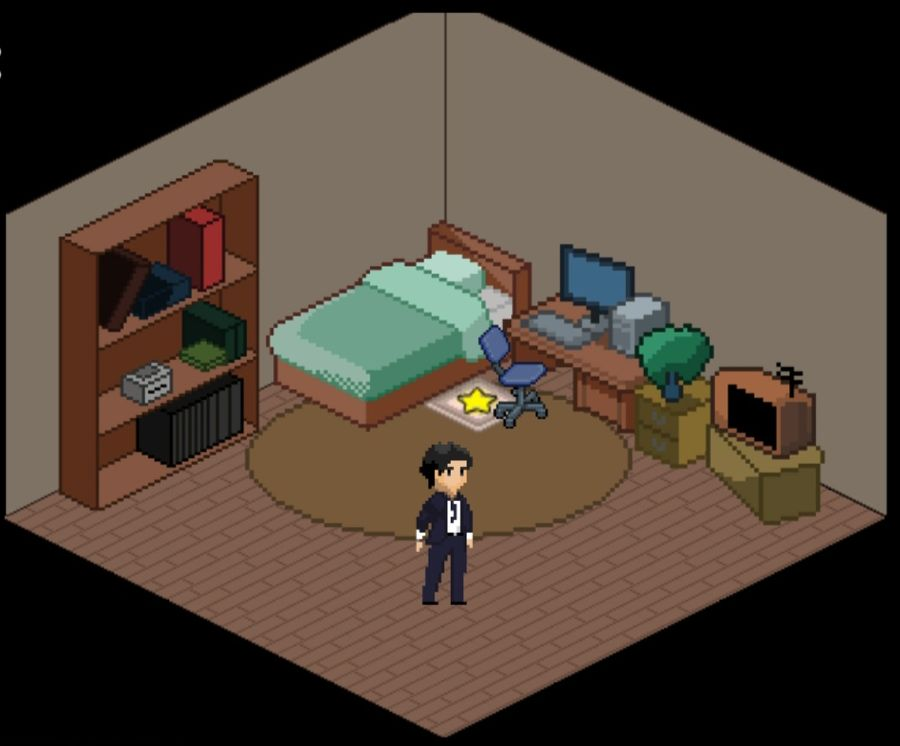
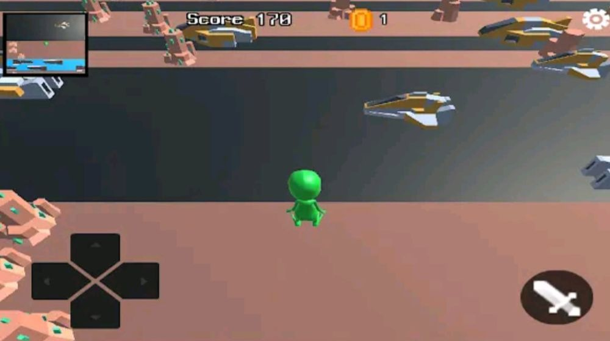
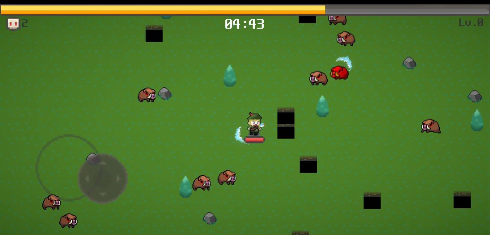
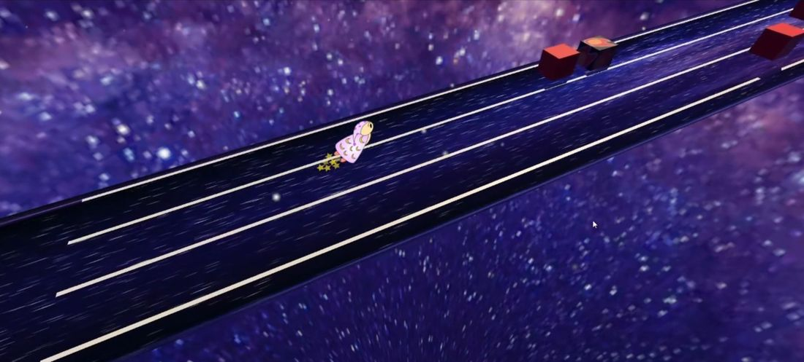
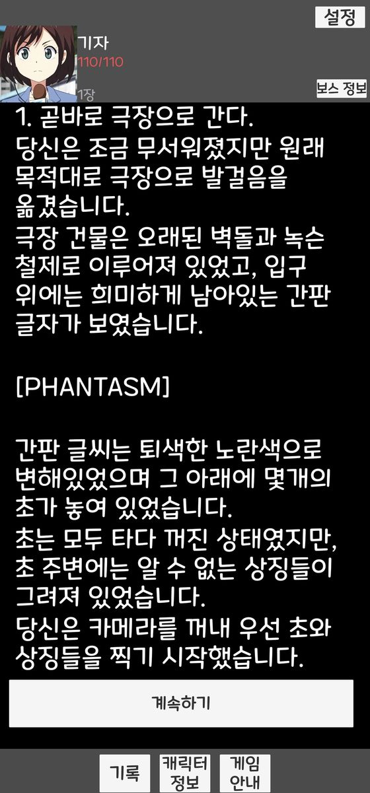

# Eleven 포트폴리오 (내용 원본)

> 홈페이지에서 포트폴리오를 관리하기 위한 내용 원본입니다. `portfolio/index.html`(화면 + 인쇄용 A4 4쪽)과 내용이 같습니다.
> 이미지는 `assets/portfolio/` 에 있습니다. 이 문서 기준 경로는 `../assets/portfolio/…`, 홈페이지(`index.html`) 기준 경로는 `assets/portfolio/…` 입니다.
> 이 파일은 사이트에 배포되지 않습니다(`docs/` 는 배포 제외).
>
> 버전: v1.1 · 2026.11

---

## 1. 요약

- **역할:** Unity 게임 프로그래머
- **이름:** Eleven
- **학교:** (현)광운대학교 게임프로그래밍학과 재학 중

Unity와 C#으로 게임 5개를 만들었고, 그중 3개를 플레이스토어에 출시했습니다. 최근 세 프로젝트에서는 모두 메인 프로그래머를 맡았습니다.

| Unity 프로젝트 | 플레이스토어 출시 | 메인 프로그래머 |
|:-:|:-:|:-:|
| 5개 | 3개 | 3회 |

### 할 수 있는 것

- **모바일 게임을 출시까지 완성할 수 있습니다.**
  DNA, OrBit, 판타즘 초대장 사건을 Unity로 만들어 플레이스토어에 출시했습니다.
- **외부 데이터를 게임과 연동할 수 있습니다.**
  OrBit에서 구글 스프레드시트를 Unity와 네트워크로 연동하고, 상점 시스템을 구현했습니다.
- **팀 프로젝트의 개발을 맡아 이끌 수 있습니다.**
  악몽회귀자(팀 log6)에서 메인 프로그래머와 PD를 함께 맡았습니다.

### 정보

| 항목 | 내용 |
|---|---|
| 관심 분야 | AI Agent 게임 개발 |
| 사용하는 기술 | Claude Code + Unity |
| 이메일 | [hdgehsdj.sn@gmail.com](mailto:hdgehsdj.sn@gmail.com) |
| GitHub | [github.com/RIKKA7061](https://github.com/RIKKA7061) |
| YouTube | [youtube.com/@Sanamichi_Dev](https://www.youtube.com/@Sanamichi_Dev) |
| 플레이스토어 | [개발자 페이지 (육하원칙)](https://play.google.com/store/apps/dev?id=8043178918719227338) |

---

## 2. 대표 프로젝트

모두 Unity와 C#, 최근 순서입니다.

### 악몽회귀자

- **기간:** 2024.08 – 2024.12
- **태그:** 로그라이크 · 2D 쿼터뷰 · PC
- **팀:** log6
- **역할:** 메인 프로그래머, PD
- **한 일**
  - 메인 프로그래머와 PD를 함께 맡아 개발과 프로젝트 진행을 담당했습니다.
- **게임 페이지:** `games/nightmare-regressor/`

### OrBit

- **기간:** 2024.03 – 2024.06
- **태그:** 아케이드 러너 · 3D · 모바일
- **팀:** i5
- **역할:** 메인 프로그래머
- **한 일**
  - 구글 스프레드시트와 Unity를 네트워크로 연동했습니다.
  - 상점 시스템을 구현했습니다.
  - 플레이스토어에 출시했습니다.
- **플레이스토어:** [play.google.com/store/apps/details?id=com.DefaultCompany.Orbit](https://play.google.com/store/apps/details?id=com.DefaultCompany.Orbit)
- **게임 페이지:** `games/orbit/`

### DNA

- **기간:** 2023.08 – 2023.12
- **한 줄 소개:** 쫓아오는 동물들을 구덩이로 밀어 넣는 게임
- **태그:** 뱀서라이크 · 2D · 모바일
- **팀:** 육하원칙
- **역할:** 프로그래머, 기획
- **주요 기능:** 성장 시스템, 구덩이 시스템, 무한 맵
- **한 일**
  - 팀 개발에 GitHub를 적용했습니다.
  - 플레이스토어에 출시했습니다.
- **플레이스토어:** [play.google.com/store/apps/details?id=com.SixRules.DNA](https://play.google.com/store/apps/details?id=com.SixRules.DNA)
- **게임 페이지:** `games/dna/`

---

## 3. 문제 해결

뉴메로스 (2023.03 – 2023.06), 별을 먹기 위해 달려가는 리듬게임

| 단계 | 내용 |
|---|---|
| 문제 | 플레이어가 별에 닿아도 별이 사라지지 않고 그대로 통과했습니다. |
| 해결 | 플레이어와 별이 닿으면 별이 사라지도록 하는 스크립트를 추가했습니다. |
| 결과 | 게임에서 자연스러운 연출이 나오도록 개선했습니다. |

### 첫 프로젝트의 아쉬움을 다음 프로젝트에서 해결했습니다

| 이전 (뉴메로스) | 다음 프로젝트 |
|---|---|
| 출시하지 못했고, 발표 때는 빌드가 없어 영상으로 소개했습니다. | **DNA, OrBit, 판타즘 초대장 사건:** 세 게임을 플레이스토어에 출시했습니다. |
| GitHub 없이 개발했습니다. | **DNA:** 팀 개발에 GitHub를 적용했습니다. |

---

## 4. 기술

자신 있는 순서입니다.

### C# · 수준 중 (★★☆)

Unity 프로젝트 5개의 게임 로직을 C#으로 작성했고, 최근 세 프로젝트에서 메인 프로그래머를 맡았습니다.

> 수준 기준: **상** 남이 짠 코드도 고쳐 쓸 수 있음, **중** 원하는 기능을 응용해 구현할 수 있음, **하** 코드를 읽고 이해할 수 있음

| 기술 | 내용 |
|---|---|
| Unity | 3D 리듬게임과 러너, 2D 뱀서라이크와 쿼터뷰 로그라이크, 텍스트 RPG까지 5개를 만들었습니다. |
| 모바일 빌드와 출시 | DNA, OrBit, 판타즘 초대장 사건을 Android로 빌드해 플레이스토어에 출시했습니다. |
| 구글 스프레드시트 연동 | OrBit에서 스프레드시트 데이터를 Unity와 네트워크로 연동했습니다. |
| Git, GitHub | DNA 팀 개발에 GitHub를 적용했습니다. |
| AI 코딩 도구 | 뉴메로스에서 ChatGPT로 스크립트를 작성했고, 지금은 Claude Code와 Unity로 개발합니다. |

---

## 5. 별첨

### 전체 프로젝트 (최신순)

| 썸네일 | 프로젝트 | 기간 | 내용 |
|---|---|---|---|
|  | 판타즘 초대장 사건 | 2024.12 | 텍스트 RPG, 2D, 모바일. 친구들과 처음 진행한 사이드 프로젝트에서 메인 프로그래머를 맡아 플레이스토어에 출시했습니다. |
|  | 악몽회귀자 | 2024.08 – 2024.12 | 로그라이크, 2D 쿼터뷰, PC. 팀 log6에서 메인 프로그래머와 PD를 맡았습니다. |
|  | OrBit | 2024.03 – 2024.06 | 아케이드 러너, 3D, 모바일. 팀 i5의 메인 프로그래머로 구글 스프레드시트 네트워크 연동과 상점 시스템을 구현하고 출시했습니다. |
|  | DNA | 2023.08 – 2023.12 | 뱀서라이크, 2D, 모바일. 팀 육하원칙에서 프로그래머와 기획을 맡았고, GitHub를 적용해 출시했습니다. |
|  | 뉴메로스 | 2023.03 – 2023.06 | 리듬게임, 3D, Windows. 첫 Unity 프로젝트로, 프로그래머를 맡아 3D 노트가 움직이는 이동 시스템을 만들었습니다. |

### 첫 프로젝트 회고 (뉴메로스)

- **아쉬운 점:** 미출시, UI 미부착, 생성 시스템 미적용, GitHub 미사용, 발표 때 빌드가 없어 영상으로 소개
- **얻어간 것:** 첫 Unity 입문, ChatGPT로 스크립트 작성, 좋은 팀원들

### 링크

| 이름 | 주소 |
|---|---|
| GitHub | [github.com/RIKKA7061](https://github.com/RIKKA7061) |
| YouTube | [youtube.com/@Sanamichi_Dev](https://www.youtube.com/@Sanamichi_Dev) |
| 플레이스토어 개발자 | [play.google.com/store/apps/dev?id=8043178918719227338](https://play.google.com/store/apps/dev?id=8043178918719227338) |
| DNA | [play.google.com/store/apps/details?id=com.SixRules.DNA](https://play.google.com/store/apps/details?id=com.SixRules.DNA) |
| OrBit | [play.google.com/store/apps/details?id=com.DefaultCompany.Orbit](https://play.google.com/store/apps/details?id=com.DefaultCompany.Orbit) |
| 이메일 | [hdgehsdj.sn@gmail.com](mailto:hdgehsdj.sn@gmail.com) |

---

## 홈페이지에서 쓸 때 참고

- 디자인은 `THEME.md`, 도트 글꼴·별 배경·네온 같은 효과는 `assets/fx.css`, `assets/fx.js` 를 그대로 가져다 쓰면 됩니다.
- 효과 사용법: 제목에 `data-fx-drop`(글자 떨어지기), 카드에 `data-fx-tilt`(기울기 + 빛), 구역에 `data-fx-reveal`(도트처럼 나타나기), 작은 제목에 `class="fx-blink"`(깜빡이는 ▶).
- 인쇄용(A4 4쪽) 문서는 `portfolio/index.html` 에 그대로 있습니다. 홈페이지로 옮기더라도 면접용 PDF는 이 페이지의 「PDF로 저장」으로 뽑으면 됩니다.
